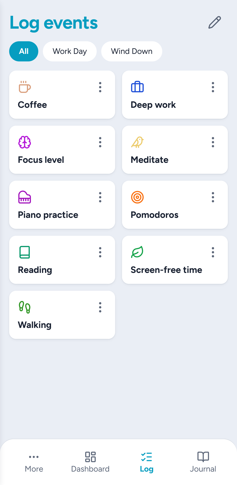
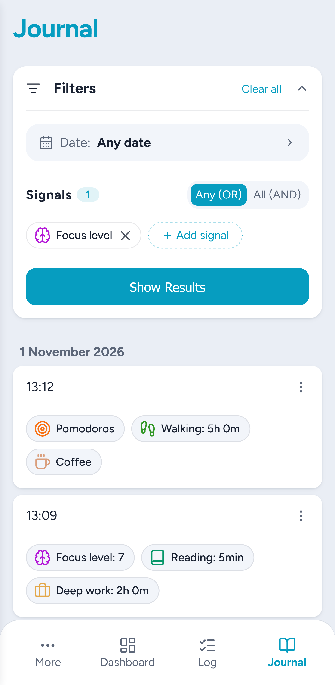
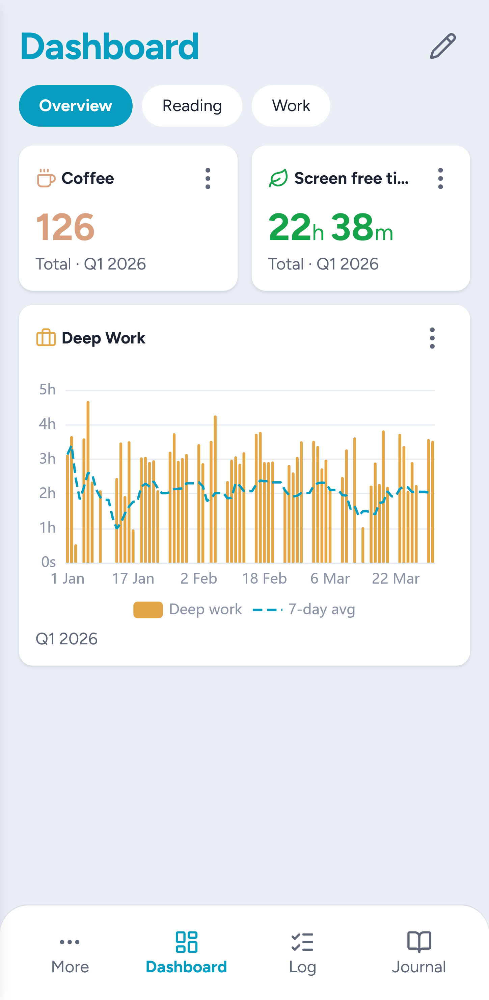

<h1 align="center">
  <picture>
    <source media="(prefers-color-scheme: dark)" srcset=".github/assets/logo-dark.svg">
    
  </picture>
</h1>

  Track anything. See the patterns. 
  Your journal, your data.

  
  

  <picture>
    <source media="(prefers-color-scheme: dark)" srcset=".github/assets/log_dark.png">
    
  </picture>
  <picture>
    <source media="(prefers-color-scheme: dark)" srcset=".github/assets/journal_dark.png">
    
  </picture>
  <picture>
    <source media="(prefers-color-scheme: dark)" srcset=".github/assets/dashboard_dark.png">
    
  </picture>

bitjournal is a self-hostable app for tracking anything you can count, rate, measure or time. Define your own signals, log them in seconds, and explore your data through customizable dashboards, charts and widgets.

- **Signals**: tally, range, value and duration types, defined by you.
- **Boards**: group signals into boards and log events in a tap.
- **Journal**: a timeline of everything you have logged.
- **Analytics**: built-in statistics and dashboard widgets.
- **Yours to keep**: run it on your own server and keep your data.

## Status

bitjournal is under **active development**. Core features are still being built and things may change. Always check the release notes before updating.

Hosted instances will be available soon, for people who would rather not run a server. See [bitjournal.me](https://bitjournal.me).

## Get started

- [Self-hosting guide](https://bitjournal.me/docs/selfhost/overview): run your own instance with Docker Compose.
- [Usage guide](https://bitjournal.me/docs/usage/getting-started): learn the concepts and how to use the app.

## Contributing

Contributions are welcome within the current scope:

- **Bug fixes and enhancements** to existing features: pull requests are welcome.
- **Feature requests**: please open a [discussion](https://github.com/simon-mettler/bitjournal/discussions), not an issue. Issues are for bugs.
- **New features**: pull requests that add whole new features are not accepted for now, until the base feature set is complete. Please open a discussion first.

Read [CONTRIBUTING.md](CONTRIBUTING.md) before opening a pull request. Report security problems privately as described in [SECURITY.md](SECURITY.md).

## Tech stack

Django and Django REST Framework (PostgreSQL) backend, Vue 3 and Vite (TypeScript) frontend.

## License

bitjournal is licensed under the [GNU General Public License v3.0](LICENSE).
